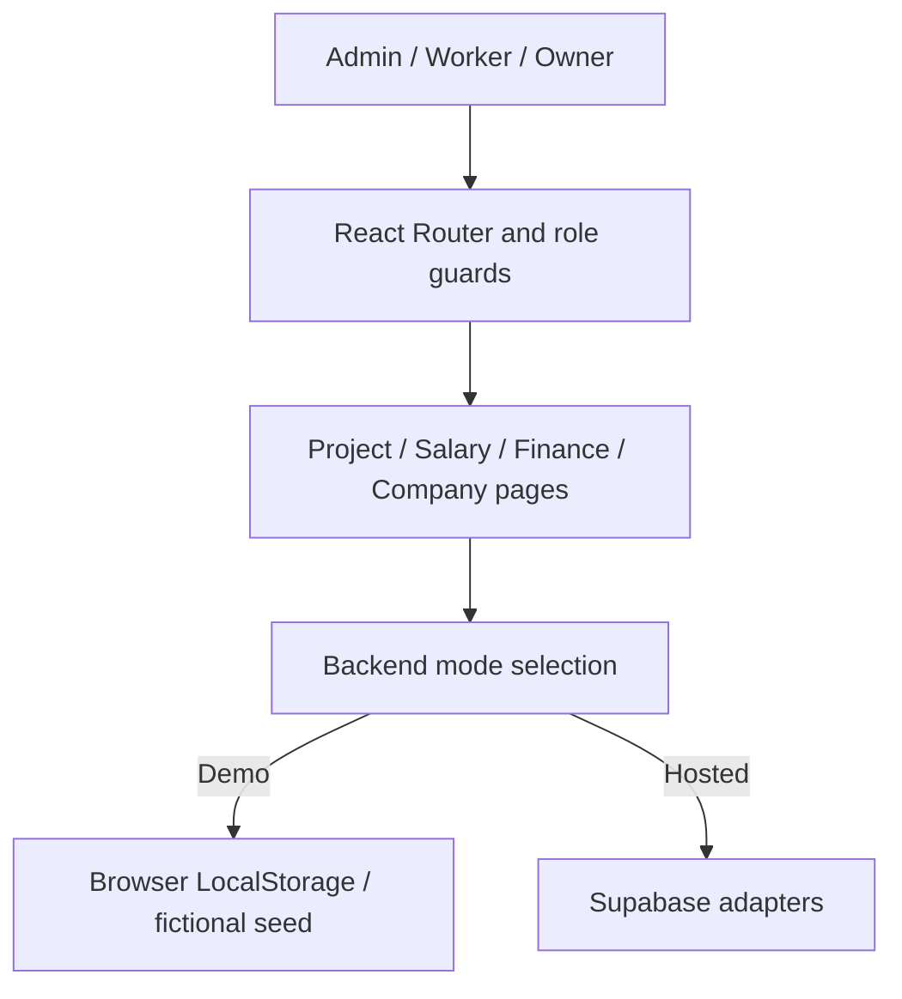

# Architecture / 系統架構

Conceptual overview, not a database audit.

The diagram is conceptual: it does not claim that every page uses an identical repository interface or that all hosted paths have been tested.

## Business data / 業務資料

Conceptual workflow: project assignments → attendance → payroll → labor cost → project and company reporting. Contracts and invoices support commercial workflows. Exact formulas, keys, event propagation, duplicate prevention and reconciliation remain subject to ongoing independent validation. No physical ERD or verified database constraints are asserted here.

## Isolation / 隔離

Demo uses fictional browser-local data; it is not a shared hosted database. Hosted code exists but hosted runtime, RLS and database performance are outside the present acceptance scope.

## Release verification / 發布驗證

2026-11-26: the public demo was switched to the CI-passing release. Recorded local acceptance: 3,523 tests across 457 files; 42/42 mock browser E2E checks; production dependency audit reported zero known advisories at release time. Hosted runtime and cloud AI are not certified; development dependency advisories remain. Public browser role-by-role retesting is pending.
